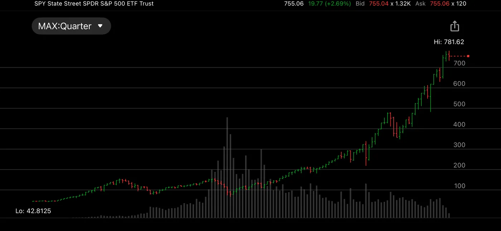

SPY季线，从1994年的42块，到今天的755。自己1994年到纽约，几乎是从图的最左边走过来的。

1995到2002，做经纪人，亲眼看着它从五十冲到一百五，又跌回七十。2008年再来一次，从一百五十跌到七十。从2000年到2013年，整整十三年，指数原地踏步。那十三年，很多人熬不住，下了车。

2013年以后，曲线抬头，一路走到七百多。回头看，2000年和2008年那两次让人心惊肉跳的大跌，在季线上只是两个小坑。

季线上看不见每天的涨跌，只看得见方向。复利的曲线前面平，后面陡。难的不是看懂这张图，是在那平坦的十三年里不下车。

