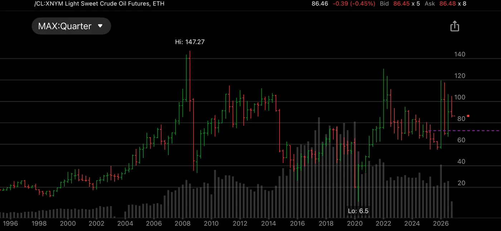

I thought CL trading was my only way going back to the top again. I basically gambled with very high leverage and results were mixed. I made $3,000,000 and lost $3,000,000. But the commission costs put me out of business. I took 10 contracts on average. Sometimes I would load up 20 contracts. $15000 daily swings was normal. It was extremely stressful. But I was convinced that a little guy like me needed high leverage to get rich. Making $5000 a day, $1,000,000 was my goal. It’s laughable when we are looking back. But that was the true driving force behind my extremely hard working life.

