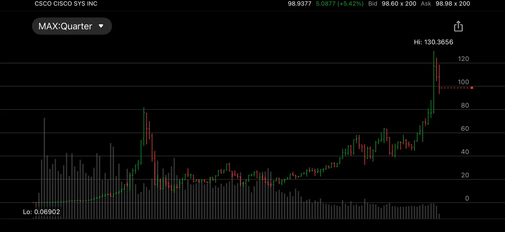

CSCO was the chance of a lifetime for me. I was so lucky that I started my stock brokerage career in December 1994. I kept buying it as it went from $2 to $80. I made $10 million for my clients and $450,000 for myself. It was the best investment I ever made. It makes routers which empowered the internet revolution. I exited our position near the peak around $78.50. It made me proud and happy.

