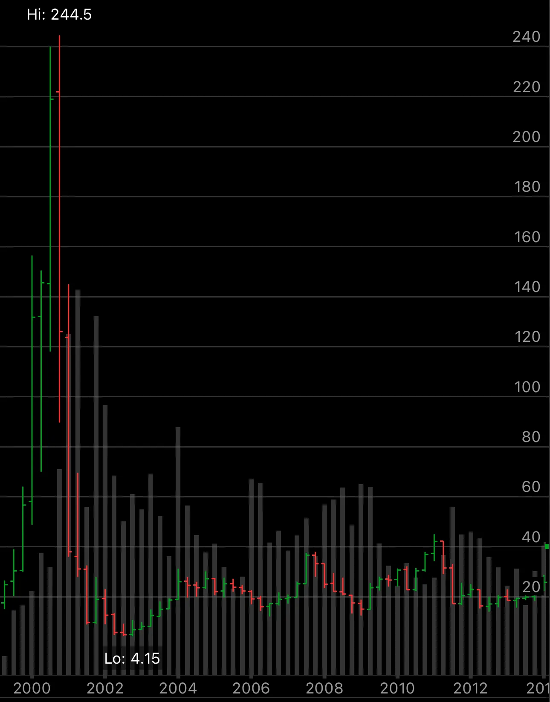

I had 2,000 shares of JNPR, 2,000 shares of JDSU and 2,000 shares of AMCC during the March 2000 crash. Each one gave me a $150,000 loss. The pain and fear were unbelievable. It marked the start of a long-lasting period of struggle in my life. I was totally shocked and lost.

