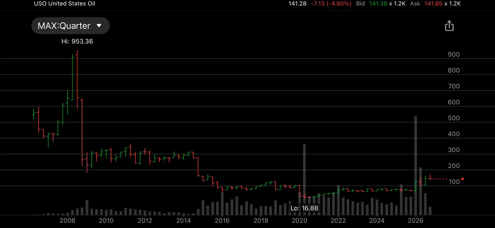

USO is sold as a way to own oil, but it doesn't hold a single barrel. It holds futures contracts, and every month it must sell the expiring one and buy the next. When later months cost more, each roll loses a little money. Year after year, those small losses add up.

The chart shows the result. Oil today trades in the same broad range as in 2008, yet USO has lost most of its value since then. In 2020, when oil futures briefly went negative, it was crushed and later did a 1-for-8 reverse split.

It isn't illegal; the prospectus explains it all. But many people bought it believing it tracks oil over time, which it was never built to do.

I traded CL futures myself for years and roughly broke even, losing on commissions and spreads. USO taught the same lesson at a larger scale: in futures-based products, time works against you. With SPY, time works for you.

