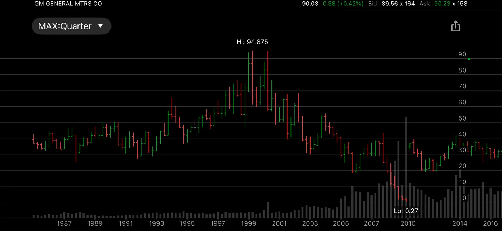

The End of My Put-Writing Business

For three years, writing puts worked well. I wrote them on just three stocks, collected premiums each month, and most contracts expired worthless. It felt like a steady business.

Then came GM. I wrote 20 puts the month GM went bankrupt. The stock fell toward zero, and I lost $68,000 on that single trade. It brought my put-writing business to a full stop.

The chart shows how fast it happened: from the 90s near $95 down to $0.27 in 2009. Shareholders of the old GM were wiped out, and the new GM that relisted in 2010 was a different company.

With only three names, one bankruptcy was enough to end everything. A well-diversified portfolio could have absorbed one failure; three stocks could not.

That trade is part of why my rules today are simple: no leverage, DCA into steady holdings, and SPY-RSI tested with just 10 shares. Disciplined risk evaluation: a must.

