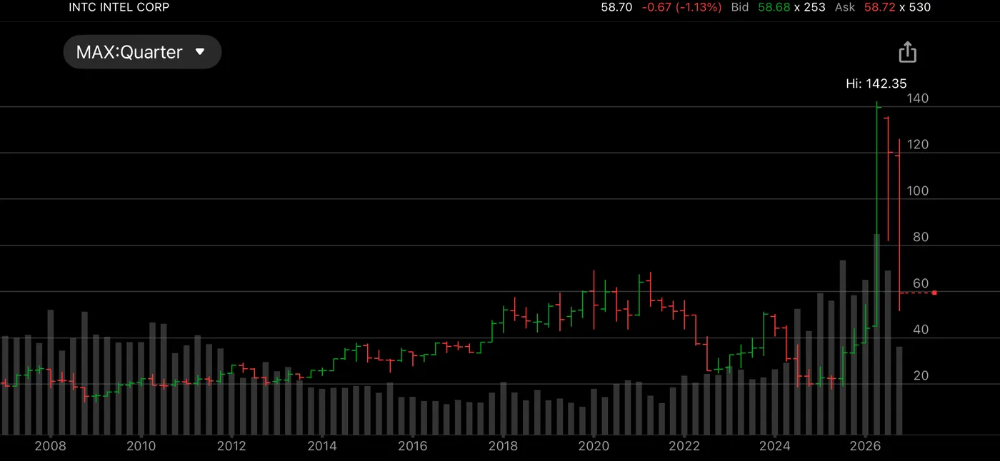

In the 1990s, Intel was the heart of the PC and internet revolution. As a broker, I watched it climb quietly for years, then run straight up into the 2000 peak near $75. Within two years it was below $15. Then it drifted for two decades, a great company whose stock went nowhere.

In 2026 it happened again, this time riding AI. Intel was never an AI leader, but as the AI trade spread, investors began rushing into more marginal players like Intel and memory stocks. Tight CPU supply driven by agentic AI demand fed the story.  

Politics added fuel. In August 2025, the US government took a nearly 10% stake in Intel, receiving 433.3 million shares at $20.47 each. In June 2026, the president announced that Apple had agreed to work with Intel to design and build chips in the US, and boasted that Intel had been valued at around $100 billion when the government made its offer and was now worth more than $600 billion, putting the US stake at over $60 billion. Analysts had warned from the start that "besides money, Intel needs customers." The stock spiked to $142. 

Then reality returned. Intel lost 45% of its value in October, its worst month since at least 1980, including a 29% drop on October 30, its steepest one-day drop in decades, after it warned that a global slump in PC sales would drag on into next year. One analyst called it a "huge disconnect" between the stock's hype and Intel's near-term reality. 

Internet in 2000; AI and politics in 2026. The technology changes, the promoters change, but the crowd's urge doesn't. A real revolution can still produce a bubble in the stocks around it. That's why I DCA into broad, steady holdings and keep my trading to SPY-RSI with clear rules.

