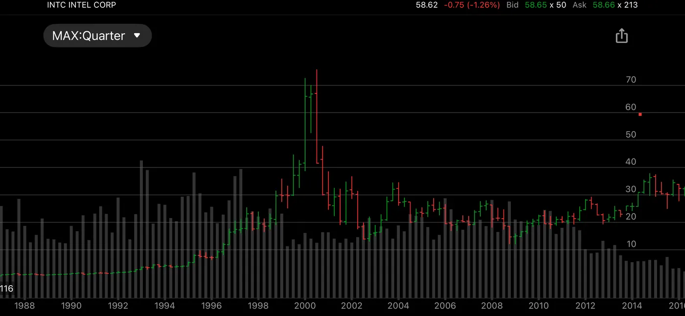

INTC was the NVDA of the 1990s. It was the dominant player in the chip industry. I traded its warrants and stock. I made some good money on them. It was hard to believe that it could do anything wrong. But the mobile revolution and LLM revolution went by without much contribution from it. Today its fate is still uncertain.

