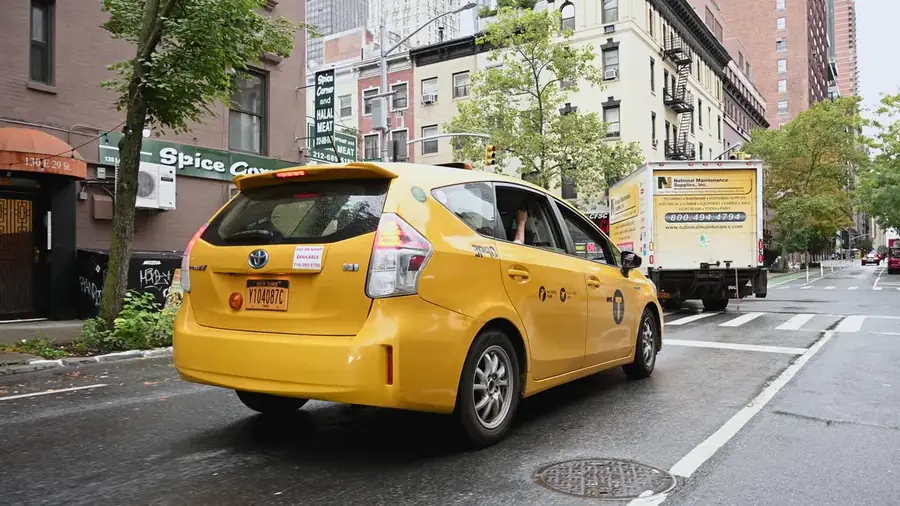

My largest loss wasn’t in the stock market. It was the result of yellow taxi medallion prices free-falling, caused by Uber. Hailing by mobile phone replaced hailing by hand at the curb. The medallion's price went down to zero from over $1,000,000. I ended up carrying a $450,000 bank loan. I had to file Chapter 11 to get my life in order. It was the toughest moment of my entire life. I felt so good when I walked out of the bankruptcy court. From now on, the sky is the limit.

