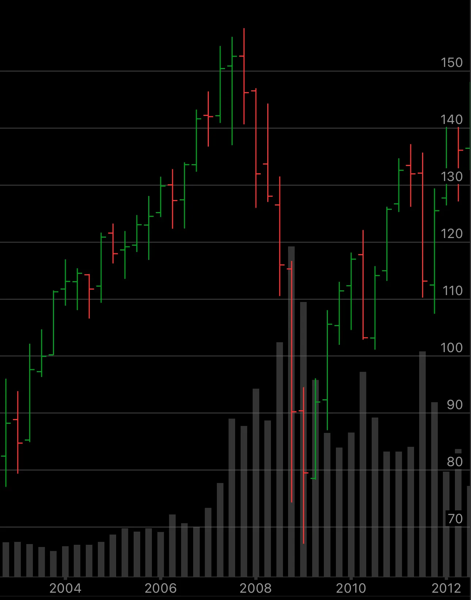

I was so happy to hear that Lehman Brothers went bankrupt. And MER GS were in deep trouble too. The second day I collected $300,000 cash and enrolled a day trading camp: time to go back Wall Street. But quickly the day trading turned sour and I just went back home and started buying stocks when SPY was around $87 in December 2008. It went down further to $69 in March 2009. Sadly I was not able to tough out the bottom process. I Toya quick 10% loss. It made me sick and unhappy for months. I was disgusted with my own lack of ability to handle my own emotions and finance. If I could DCA BRK/B , it was traded around $85, it would be more than $2,000,000 today. But I wasn’t able to make it happen back then.

