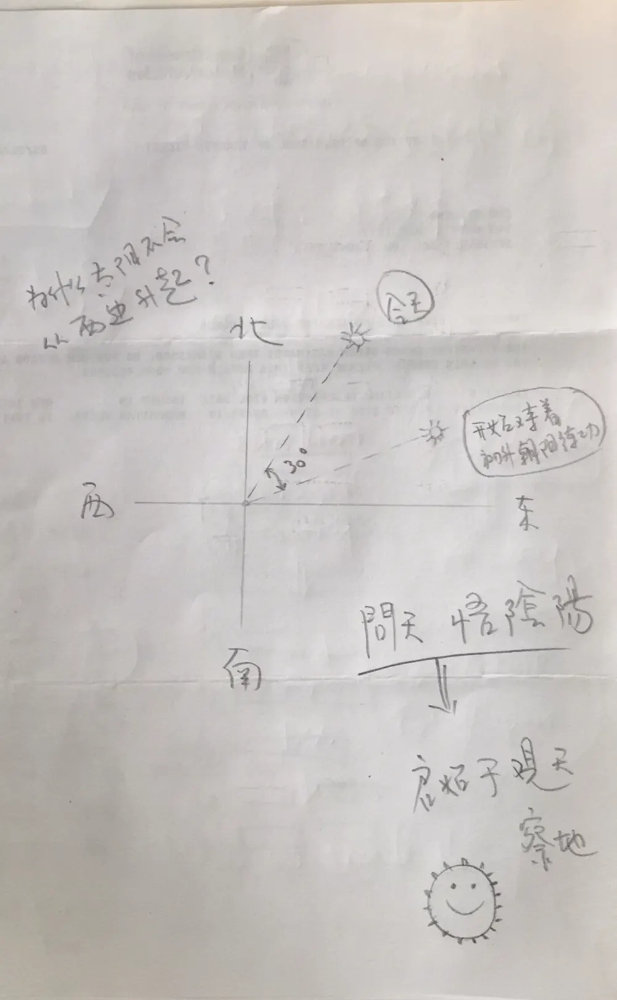

为什么太阳不会从西边升起？这是孩子的问题，却能引出很深的道理。

太阳总是从东方升起，但每天升起的位置并不相同。春分、秋分时，太阳从正东升起；夏天偏向东北，冬天偏向东南。在纽约，北纬约41度，夏至日出大约在正东偏北32度。我的草图画的是30度，纸笔之间，也算八九不离十。

原因在于地球的倾斜，约23.4度。地球绕日运行，这个倾角让日出点一年之中在地平线上南北摆动，像一只缓慢的钟摆。古人正是观察这一摆动来定历法：二至二分，二十四节气。

问天，悟阴阳。太阳北移，是阳长；南移，是阴长。君子观天察地，顺着天地的节律安排自己的生活：日出而作，日落而息，顺应四时。

