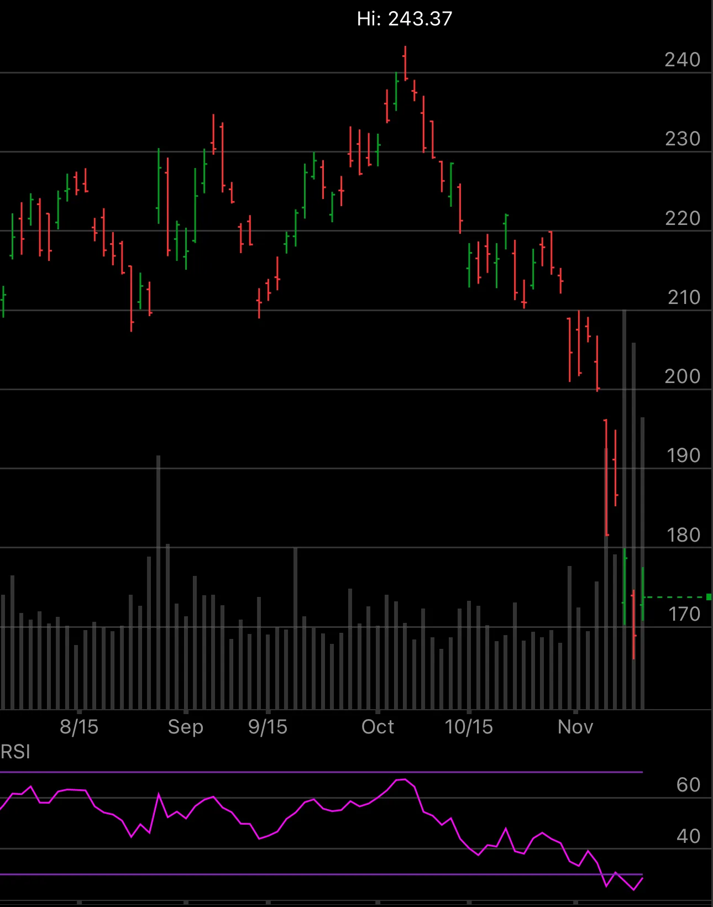

NVDA-RSI == 28.7369; it gives a buy signal. NYT reported that Jensen had a relationship with a former tech executive, and Nvidia’s board has opened an investigation into whether he was the target of a Chinese intelligence effort. Who is behind this news? I suspect some very powerful people want to oust Jensen Huang. Things are just getting started, so be ready for the worst. It could be a great buying opportunity for us.

