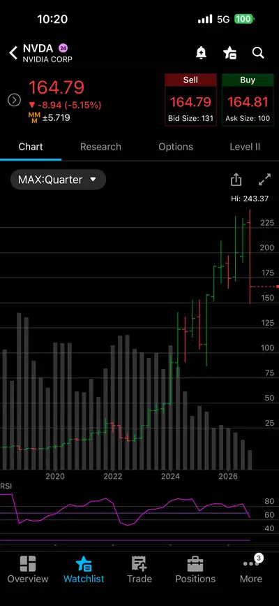

There is no better case study than NVDA at this moment. It sits at the intersection of China–US competition in AI. Its management reshaping is unfolding. Its GPUs are still in demand. What do all these changes mean for its future GPUs and CUDA?

