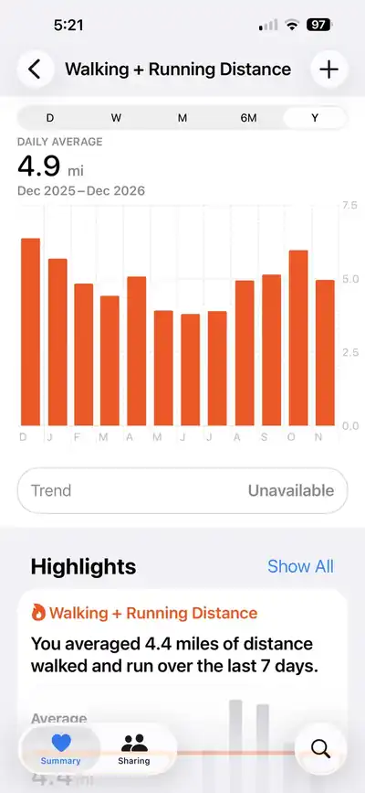

I walked 4.9 miles a day over the past year, the result of working in an Amazon warehouse as a T1 associate. It is the cornerstone of my 内经养生、人尽天年 goal. It gives me a steady income, health insurance, slow walking, and the contact with people I need. I get what I need, no matter how other people feel about it. It’s one of the best decisions I’ve ever made.

