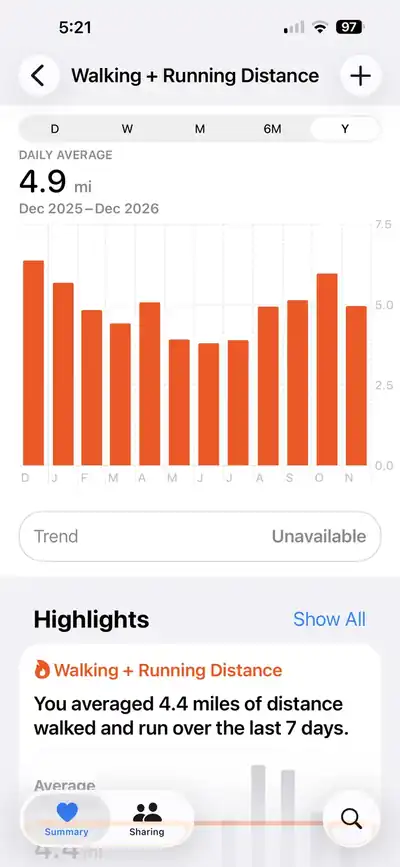

I walked 4.9 miles per day in last year. It was the outcome of working for Amazon warehouse as a T1 associate. It is the cornerstone of my 内经养生人尽天年的目标。it gives me a steady income, health insurance, slowing walking and needed communication with people. I do get what I need no matter how other people feel about it. It’s one of my best decisions ever made in my life.

