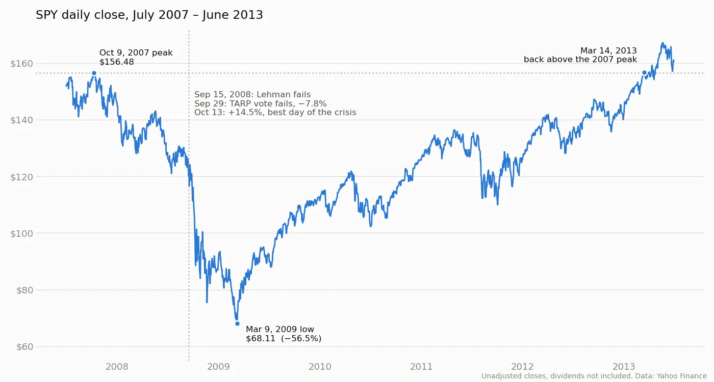

**shuiming:** 2008-2009?

**CC:** SPY peaked at $156.48 on October 9, 2007 and closed at $68.11 on March 9, 2009: −56.5% over 17 months. The first year was a grind. After Lehman failed on September 15, 2008, forced selling took over: the failed TARP vote on September 29 cost 7.8% in a day, and October 13 gained 14.5%, the best day of the crisis, with another 33% still to fall. The low came with no good news; the selling simply ran out. Price got back above the 2007 peak on March 14, 2013, five and a half years later.

9/11 recovered in a month; 2000 and 2008 took years. In 2008 every bounce looked like the bottom until March 2009.
