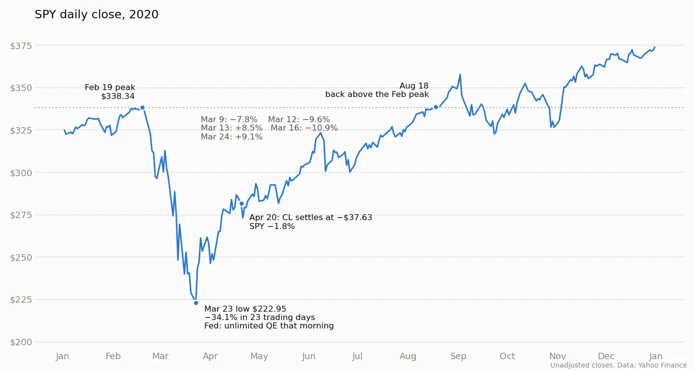

**shuiming:** 2020?

**CC:** The fastest bear market on record: SPY fell from $338.34 on February 19 to $222.95 on March 23, −34.1% in 23 trading days. March 9 −7.8%, March 12 −9.6%, March 13 +8.5%, March 16 −10.9% (the worst day since 1987), March 24 +9.1%: margin calls and deleveraging, money forced to move. The low came the morning the Fed announced unlimited asset purchases, a buyer with no limit. On April 20, when CL settled at −$37.63, SPY lost only 1.8%. SPY was back above the February peak on August 18.

The deepest fast drop and the fastest full recovery of the four. Also the year of my $20,000 on ES.
