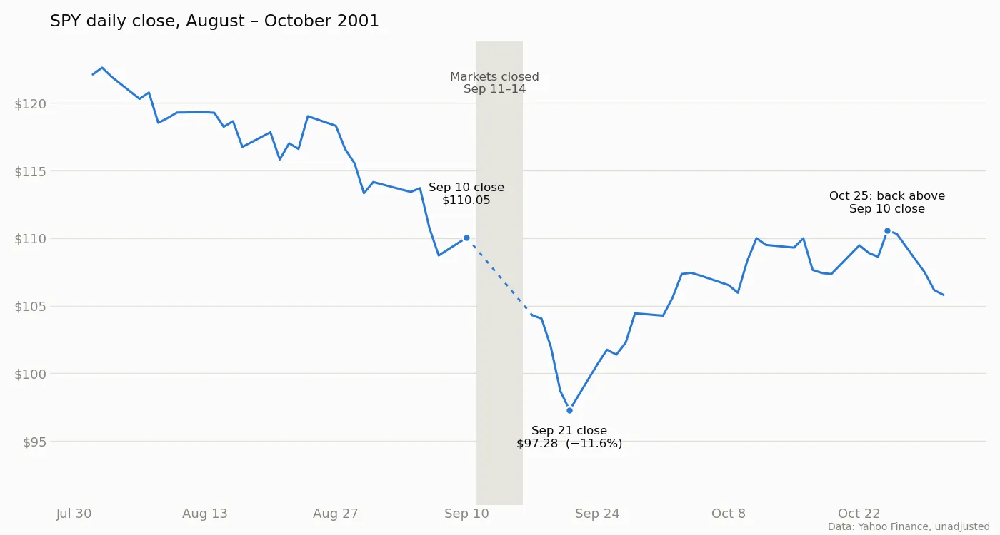

**shuiming:** 9/11, March 2000, 2008, 2020, 2024: events, huge swings. 9/11 chart on SPY?

**CC:** SPY was already falling before the attacks, from about $122 in early August to $110.05 on September 10; the dot-com bear market was well underway. Markets were closed September 11–14. On Monday, September 17, SPY closed at $104.30 (−5.2%), and the selling ran all week to a $97.28 close on September 21 (−11.6%), with an intraday low of $93.80. It was back above the September 10 close on October 25.

Five trading days of forced selling, a bottom at the end of the first week, and the whole drop recovered in about a month. The bear market itself went on until October 2002.
