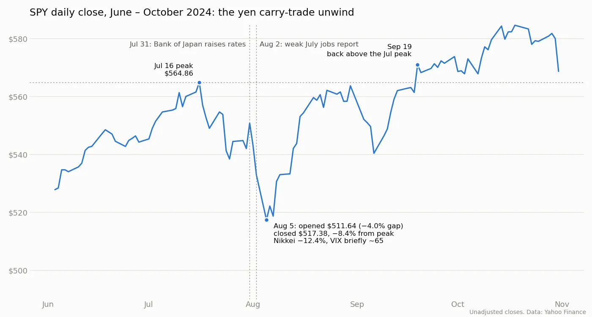

**shuiming:** August 2024?

**CC:** Two triggers three days apart: on July 31 the Bank of Japan raised rates, making borrowed yen more expensive, and on August 2 a weak July jobs report raised recession fears. On August 5 carry trades were unwound at once: the Nikkei fell 12.4% in a day and VIX briefly hit about 65. SPY gapped down 4.0% to open at $511.64 and closed at $517.38, only 8.4% below its July 16 peak. It was back above that peak on September 19.

The odd one in the series: the forced selling was in yen, Japanese stocks and volatility, not US stocks. VIX at 65 usually comes with a 30–50% decline; this time SPY fell 8%. Fear priced in options can far exceed the actual damage when the forced money is somewhere else.
