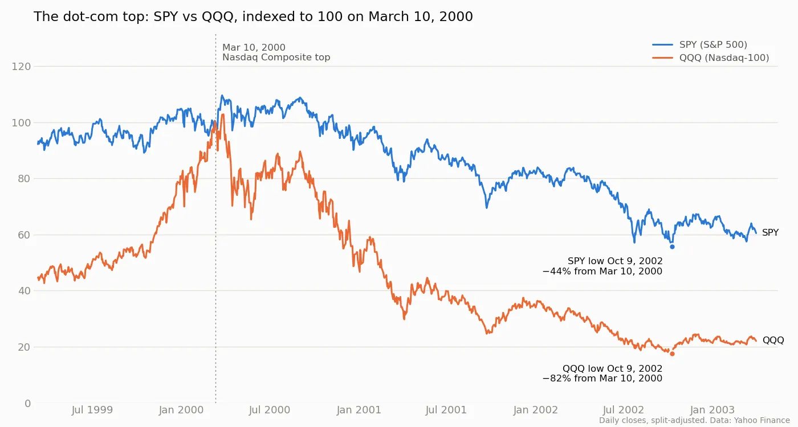

**shuiming:** March 2000?

**CC:** In the year before the top, QQQ (Nasdaq-100) more than doubled while SPY rose about 8%. The run-up was all tech. QQQ broke hard within weeks of the March 10 Nasdaq top, but SPY made its closing high on March 24 ($153.56) and held near it until September. The broad market hid the damage for six months. Both bottomed on October 9, 2002: SPY −49% from its peak, QQQ −83%.

9/11 was five days of forced selling, recovered in a month. March 2000 was a slow unwind over two and a half years, where every rally was a chance to sell. An RSI-30 buy kept working for a while, then kept failing.
