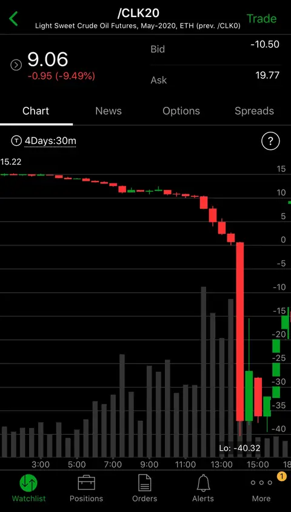

One of the most weird things happened in crude oil futures market. May 2020 crude oil futures went negative $40. Many Chinese traders lost billions of dollars.

Why it happened:

- Demand collapsed. COVID lockdowns cut global oil demand by 20–30% in April.
- Supply kept flooding in. The Saudi–Russia price war had pumps at maximum; the OPEC+ cuts agreed on April 12 only started May 1.
- Physical delivery at Cushing. Each contract held at expiry means taking 1,000 barrels in Oklahoma, and storage there was nearly full and booked.
- Forced selling into an empty bid. On April 20, the day before expiry, longs with no tanks had to get out at any price. The only buyers were firms with storage, who got paid to take the oil. The May contract settled at −$37.63.
- Retail on the wrong side. Bank of China's "Crude Oil Treasure" held May contracts to the last day.

The June contract traded near $20 that same day, and by June WTI was back near $40. It was a storage problem, not a broken market: the price of having nowhere to put the oil, squeezed into the last day of trading.
