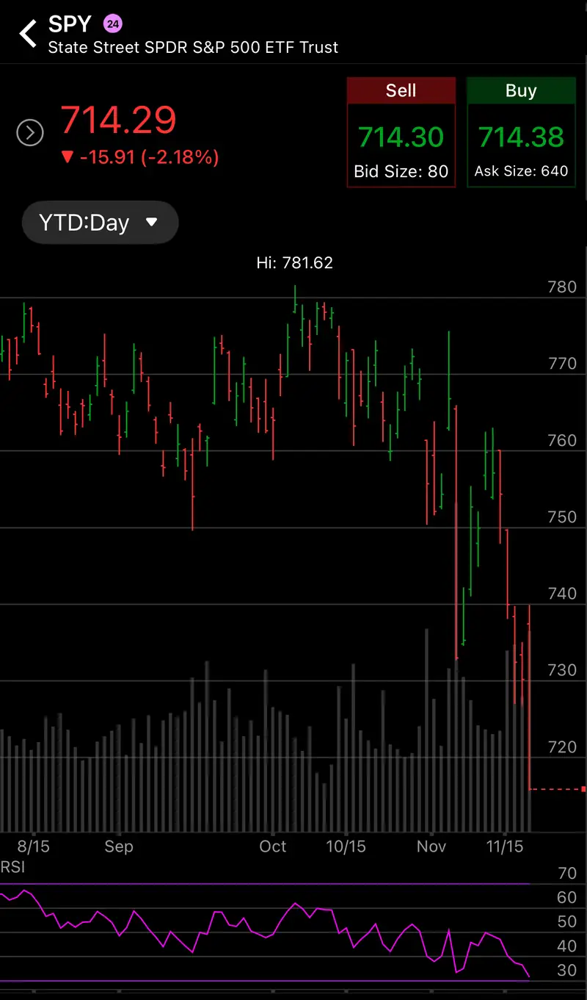

No margin means staying power when this kind of market situation is unfolding. AI stocks bleeding. NVDA is traded at $143.50, TSM is traded at $342.07.

Finally tasting the sweetness of Buffett's teaching:

> "The stock market is a device for transferring money from the impatient to the patient." — Warren Buffett

> "The first rule of compounding is to never interrupt it unnecessarily." — Charlie Munger

> "Success in investing doesn't correlate with I.Q. once you're above the level of 125. Once you have ordinary intelligence, what you need is the temperament to control the urges that get other people into trouble in investing." — Warren Buffett

