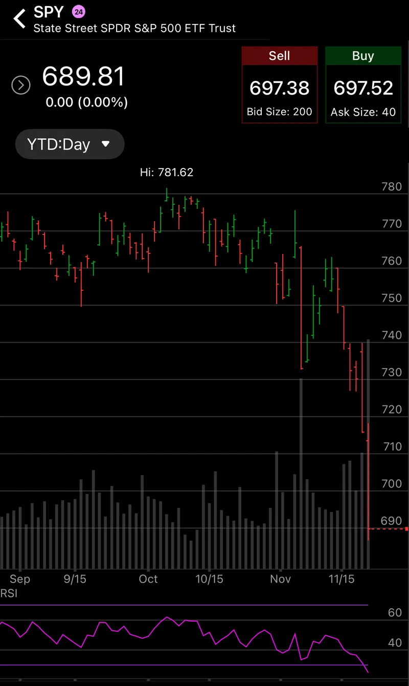

After election SPY had suffered a huge loss. Trillions dollars were lost. NVDA alone lost over 2 trillion dollars. Many employees' RSUs lost a big part of their value. Two weeks ago they were billions dollars.

This kind of free-falling market is a corner case test for DCA. It clears any delusional urges.

